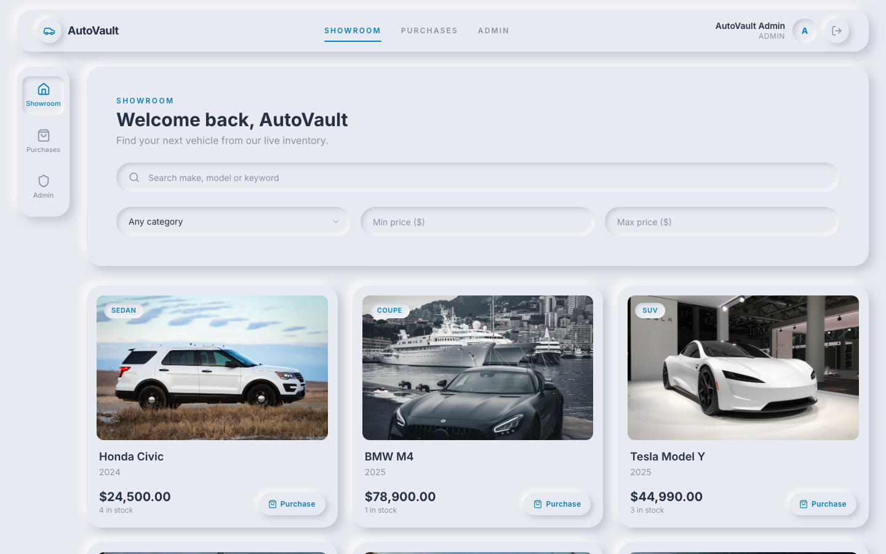
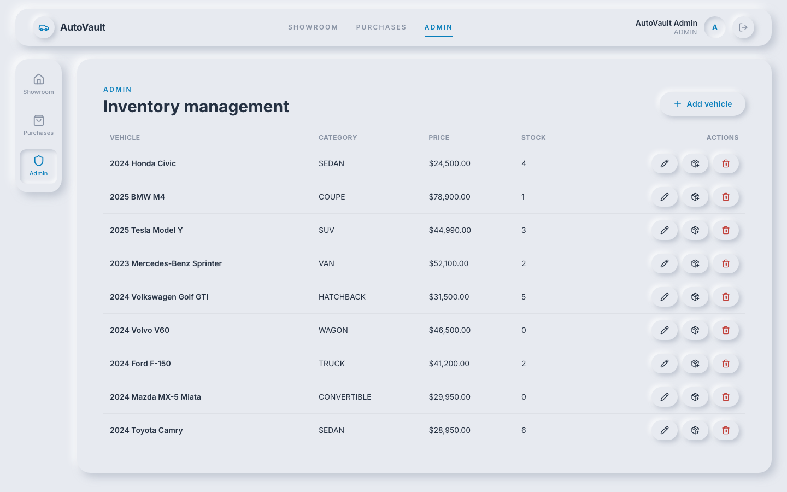
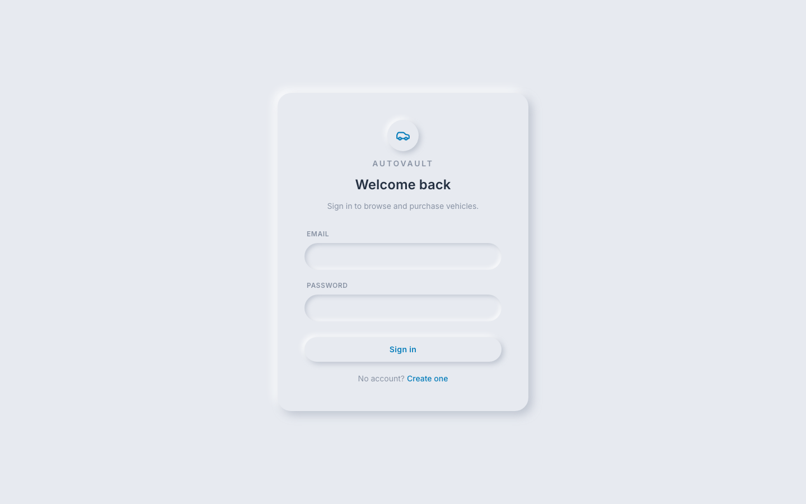
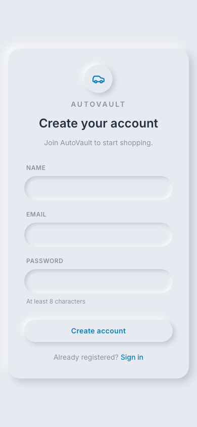

# Car Dealership Inventory System

A full-stack, test-driven car dealership inventory system: an Express 5 + PostgreSQL REST
API with JWT authentication and role-based access, and a React + Tailwind single-page app
to browse, search, purchase and manage vehicles.

**Live demo:** https://car-dealership-inventory-eosin.vercel.app
(Register a new account to shop. The admin login for the demo is provided separately to reviewers.)

**Features**

- **Accounts:** register and log in with a JWT bearer token. Two roles: `USER` and `ADMIN`.
- **Showroom:** browse all vehicles. Search by make, model or keyword, and filter by category and price range.
- **Purchasing:** the Purchase button is disabled when stock is 0. Every purchase is recorded with a price snapshot. It is race-safe: an atomic conditional decrement means 10 concurrent buyers of the last car produce exactly one sale.
- **Admin:** add, edit, soft-delete and restock vehicles.
- **Purchase history:** a page listing every user's own purchases.
- **Design:** a light neumorphism UI built to the developer's design spec ([`docs/design`](docs/design)).

## Tech stack

- **API:** Node.js 24, Express 5, TypeScript, Prisma 7, PostgreSQL 17, Zod, jose (JWT), bcryptjs
- **Web:** React 19, Vite 8, Tailwind CSS 4, TanStack Query, React Router, React Hook Form
- **Shared:** `@kata/shared`, Zod contracts used by both apps
- **Testing:** Vitest, Supertest, Testing Library, MSW, Playwright

## Repository layout

```
apps/api         Express REST API (@kata/api)
apps/web         React SPA (@kata/web)
packages/shared  Zod contracts shared by API and web (@kata/shared)
e2e              Playwright end-to-end tests (@kata/e2e)
docs             requirements, plan, architecture, ADRs, test report
```

## Getting started

Prerequisites: Node.js 24 (`nvm use`), npm 11 and Docker.

```sh
npm ci                                   # installs all workspaces and generates the Prisma client
cp apps/api/.env.example apps/api/.env   # local development settings
npm run db:up                            # Postgres on localhost:5433 (kata_dev, kata_test, kata_e2e)
npm run db:migrate                       # apply Prisma migrations to kata_dev
npm run db:seed                          # admin from SEED_ADMIN_* in apps/api/.env + 9 sample vehicles
npm run dev                              # API on :4000, web on :5173
```

## Scripts

| Command                    | What it does                                  |
| -------------------------- | --------------------------------------------- |
| `npm run dev`              | Runs the API and web dev servers concurrently |
| `npm run lint`             | ESLint, including architecture boundary rules |
| `npm run format:check`     | Prettier check                                |
| `npm run typecheck`        | `tsc --noEmit` in every workspace             |
| `npm test`                 | Unit tests (shared + API) and web tests       |
| `npm run test:integration` | API integration tests against Postgres        |
| `npm run test:e2e`         | Playwright end-to-end tests                   |
| `npm run test:coverage`    | Coverage for every workspace                  |
| `npm run build`            | Production builds of the API and web app      |

## API

Base path `/api`. Every error has the shape `{ "error": { "code", "message", "details?" } }`.

| Method | Path                         | Auth      | Notes                                                                                 |
| ------ | ---------------------------- | --------- | ------------------------------------------------------------------------------------- |
| GET    | `/api/health`                | public    | Liveness                                                                              |
| POST   | `/api/auth/register`         | public    | 201 `{ token, user }`; 409 `EMAIL_TAKEN`                                              |
| POST   | `/api/auth/login`            | public    | 200 `{ token, user }`; 401 `INVALID_CREDENTIALS`                                      |
| GET    | `/api/auth/me`               | user      | Current user                                                                          |
| GET    | `/api/vehicles`              | user      | Paginated `{ items, page, pageSize, total }`                                          |
| GET    | `/api/vehicles/search`       | user      | `q, make, model, category, minPrice, maxPrice` (cents, inclusive), `year`, `fuelType` |
| GET    | `/api/vehicles/:id`          | user      | 404 `VEHICLE_NOT_FOUND`                                                               |
| POST   | `/api/vehicles`              | **admin** | 201                                                                                   |
| PUT    | `/api/vehicles/:id`          | **admin** | Partial update; stock changes only via purchase or restock                            |
| DELETE | `/api/vehicles/:id`          | **admin** | 204; soft delete (archived), so purchase history is preserved                         |
| POST   | `/api/vehicles/:id/purchase` | user      | Body `{ quantity? }` (default 1); 201; 409 `INSUFFICIENT_STOCK`                       |
| POST   | `/api/vehicles/:id/restock`  | **admin** | Body `{ quantity }`                                                                   |
| GET    | `/api/purchases/me`          | user      | The caller's purchase history                                                         |

### Architecture

The API is a layered modular monolith: routes → service → repository **ports**, with Prisma adapters behind those ports. A single composition root ([`apps/api/src/modules/index.ts`](apps/api/src/modules/index.ts)) wires everything, so adding or removing a feature module is one line. Services never import Express or Prisma, and ESLint enforces that boundary. Unit tests run the services against in-memory fakes; integration tests run the real HTTP stack against PostgreSQL. Validation schemas live once in `@kata/shared` and are used by both the API and the web forms. The full design is in [`docs/plan.md`](docs/plan.md).

## Screenshots

| Showroom (search, filters, disabled purchase at zero stock) | Admin inventory management                                                               |
| ----------------------------------------------------------- | ---------------------------------------------------------------------------------------- |
|               |                                                   |
| **Login**                                                   | **Register (mobile)**                                                                    |
|                      |  |

My purchases: [`docs/screenshots/04-purchases.png`](docs/screenshots/04-purchases.png)

## Test Report

Run `npm run db:up && npm run test:report` to regenerate [`docs/test-report.md`](docs/test-report.md). The latest run:

| Suite                         | Tests   | Passed  | Failed |
| ----------------------------- | ------- | ------- | ------ |
| Shared contracts (unit)       | 193     | 193     | 0      |
| API (unit)                    | 70      | 70      | 0      |
| API (integration, PostgreSQL) | 21      | 21      | 0      |
| Web (React Testing Library)   | 42      | 42      | 0      |
| **Total**                     | **326** | **326** | **0**  |

The integration suite includes a concurrency test: 10 simultaneous purchases of the last unit result in exactly one sale and a stock of 0. Backend logic was built red → green, and the `test:` then `feat:` pairs are visible in `git log`.

**Known gaps (honest status):** a few things were time-boxed and are not done yet:

- OpenAPI/Swagger documentation
- Playwright end-to-end specs
- a GitHub Actions CI workflow
- form-submission tests for the admin dialogs

Late in the build, some HTTP routes, the seed and the deploy wiring were committed together with their tests rather than as separate red/green commits.

## My AI Usage

**Tools used**

- **Claude Code (Claude Opus 5.5)** was the primary tool. It acted as an orchestrator that spawned sub-agents: a planner agent, then phase agents running in parallel in isolated git worktrees.
- **ChatGPT** produced a pre-development audit that I used as a second opinion on the stack and on gaps in the requirements.

**How I used them**

1. **Requirements and stack.** I gave Claude Code the kata document and asked it to choose a stack only after reading the full scope. It chose Express + TypeScript, PostgreSQL + Prisma, shared Zod contracts and React + Tailwind. I then compared that against the ChatGPT audit. The two agreed on the core. I kept one deliberate difference: Bearer JWT instead of an HTTP-only cookie, because it matches the spec's wording and works across origins.
2. **Planning.** A planner agent produced [`docs/plan.md`](docs/plan.md): the folder tree, ports and adapters interfaces, the Prisma schema, the API contract, and a red/green commit sequence. It also checked npm package versions against the registry, and caught that `prisma@latest` resolves to an 8.0 release candidate.
3. **Implementation.** Phase agents wrote the tests first and committed them failing (`test:` commits), then committed the implementation (`feat:` commits). Agents ran in parallel in separate git worktrees, each with its own Postgres test database. Claude Code merged the branches and ran the lint, typecheck and test gate after each merge.
4. **Design.** I designed the UI direction myself (light neumorphism, [`docs/design`](docs/design)). The agents implemented it as design tokens and primitives.
5. **Review.** The orchestrator reviewed every agent report. It found and fixed issues such as the money helpers not being exported. It also rewrote commit authorship so that commits link to my GitHub account.

**Reflection**

AI made the architecture and test scaffolding dramatically faster. Parallel agents with strict file ownership and red/green rules produced a clean, traceable history. Human decisions still mattered where the spec was ambiguous:

- purchase semantics: recorded purchases with a price snapshot
- the role matrix
- soft deletes
- fixed categories
- the design language

The biggest risk was speed against quality. Time-boxing the agents left some phases partial, and I've recorded that honestly in the commit history and in the status below. Every commit made with AI carries a `Co-Authored-By: Claude` trailer, and the raw session log is in [`PROMPTS.md`](PROMPTS.md).

## Deployment

The app is deployed on **Vercel** as a single project, with a **Neon** PostgreSQL database provisioned through the Vercel Marketplace.

- [`scripts/build-vercel.mjs`](scripts/build-vercel.mjs) emits a Vercel Build Output bundle. The React SPA is served as static files, and the Express API is bundled with esbuild into one Node serverless function that serves `/api/*`. Both share an origin, so CORS is not needed.
- Both the local server and the serverless function use the same composition code, [`apps/api/src/bootstrap.ts`](apps/api/src/bootstrap.ts).
- To deploy:

```sh
npx vercel link                                               # once
npx vercel env pull .env.local                                # Neon DATABASE_URL(_UNPOOLED)
DIRECT_DATABASE_URL=$DATABASE_URL_UNPOOLED npx prisma migrate deploy   # from apps/api
node scripts/build-vercel.mjs && npx vercel deploy --prebuilt --prod
```

Production env vars: `DATABASE_URL` (set by Neon), `JWT_SECRET`, `NODE_ENV=production`, `CORS_ORIGINS`, `TRUST_PROXY=1`.
